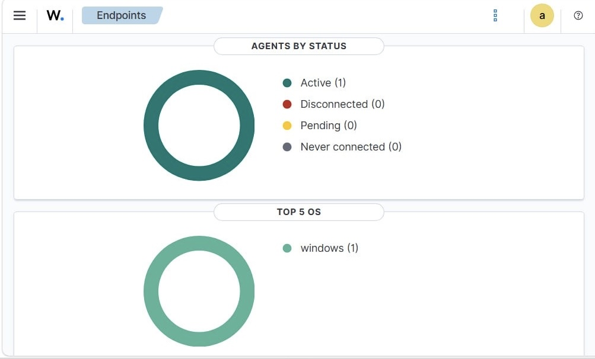
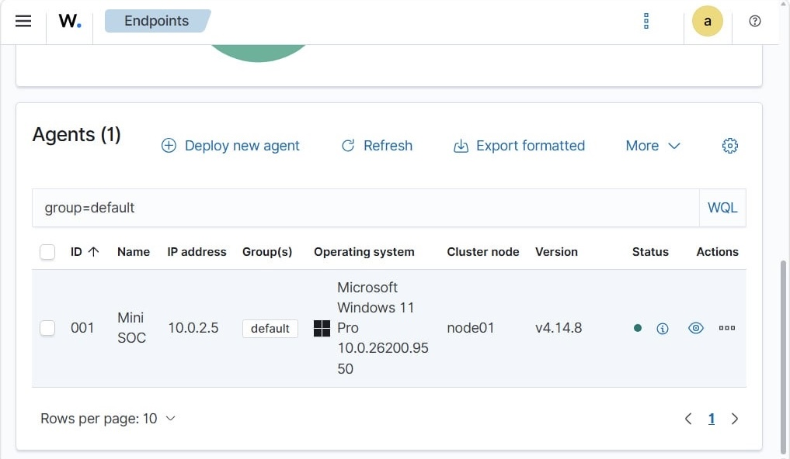
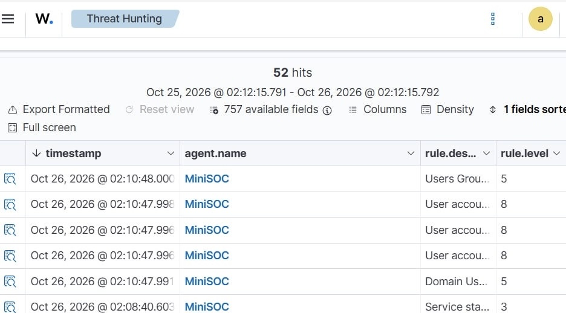
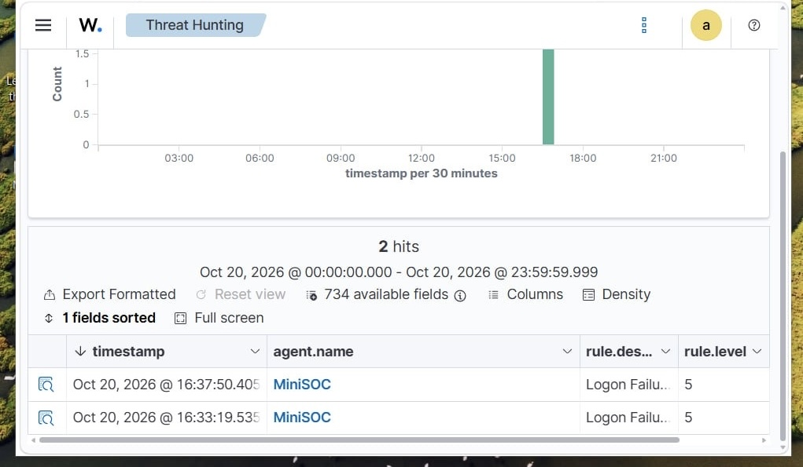
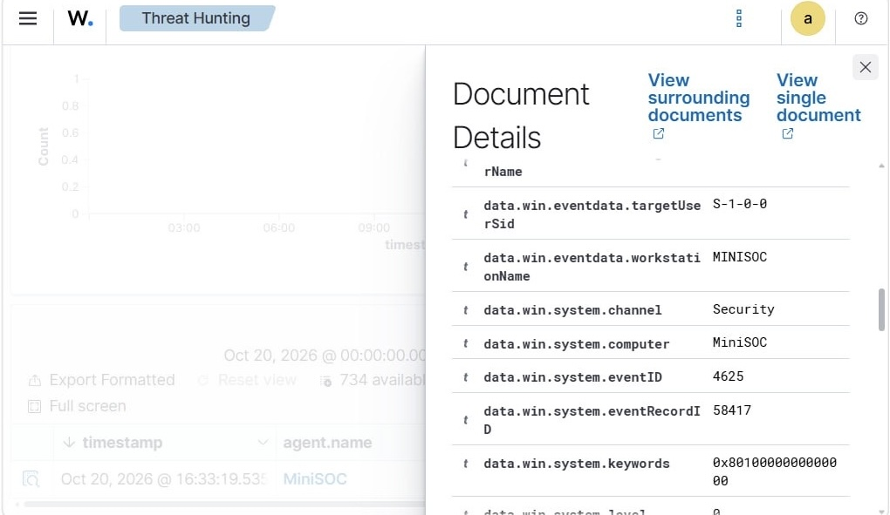
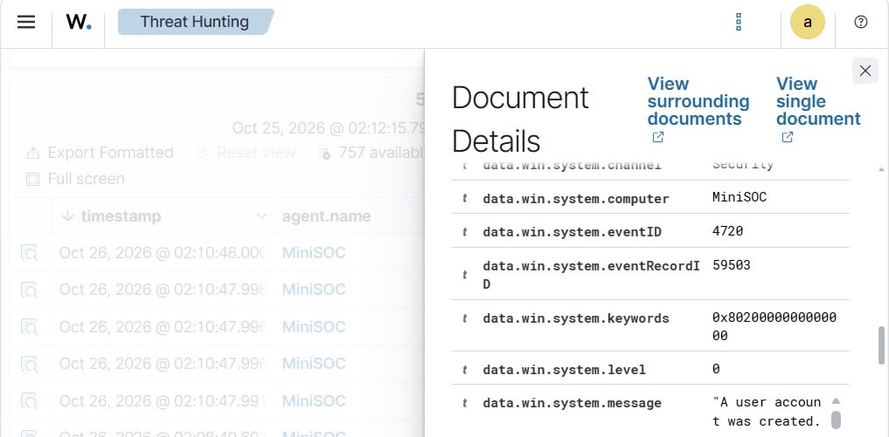
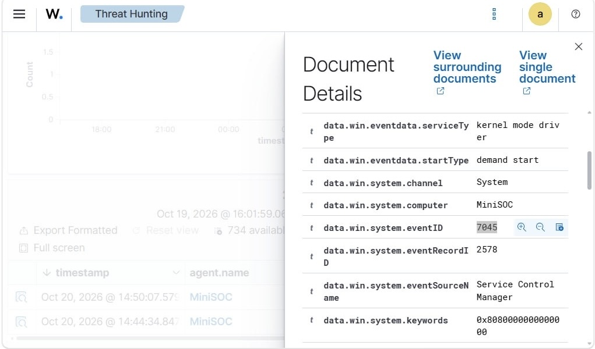
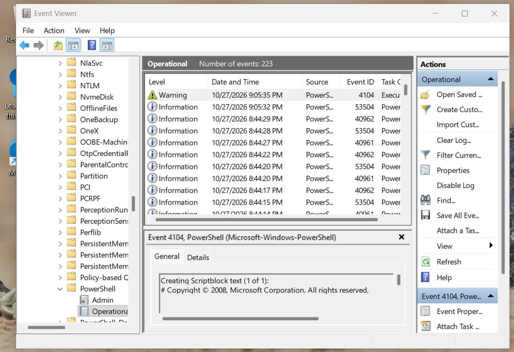
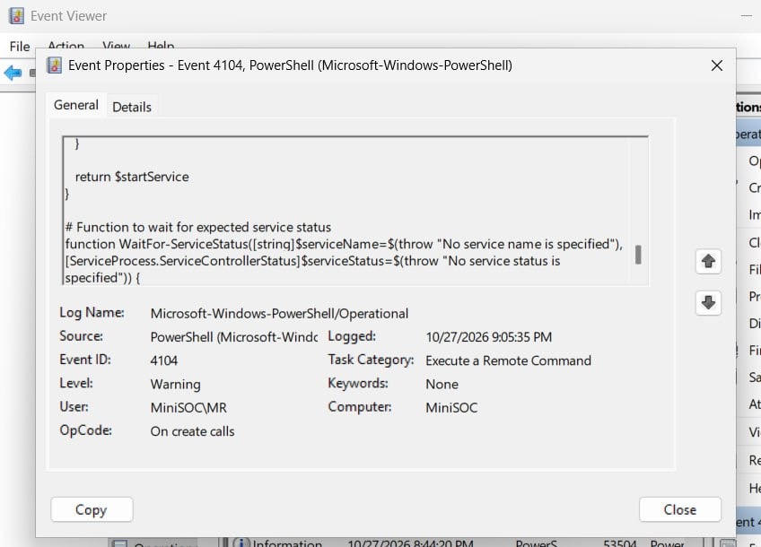

# Mini SOC & Windows Incident Investigation Lab

## Overview

This project is a hands-on Security Operations Center (SOC) lab focused on Windows security monitoring, alert detection, triage, and incident investigation.

The lab simulates a small monitoring environment consisting of a Windows 11 endpoint and a Wazuh-based security monitoring server. Security events are generated on the endpoint, collected and analyzed, then investigated through a structured incident response workflow.

## Objectives

- Monitor Windows security events.
- Detect suspicious activity through security alerts.
- Perform alert triage and investigation.
- Analyze authentication, PowerShell, account, privilege, and process-related activity.
- Create and test custom detection rules.
- Map relevant activity to MITRE ATT&CK.
- Collect and document investigation evidence.
- Build incident timelines and determine appropriate response actions.

## Lab Architecture

```
┌──────────────────────┐
│    Windows 11 VM     │
│      Endpoint        │
└──────────┬───────────┘
           │
      Wazuh Agent
           │
           ▼
┌──────────────────────┐
│    Ubuntu Server     │
│    Wazuh Manager     │
└──────────┬───────────┘
           │
           ▼
┌──────────────────────┐
│ Security Alerts      │
│ & Event Analysis     │
└──────────┬───────────┘
           │
           ▼
┌───────────────────────┐
│ Alert Triage &        │
│ Incident Investigation│
└───────────────────────┘
```

## Environment

| Component | Technology |
|---|---|
| Endpoint | Windows 11 Pro |
| Monitoring Server | Ubuntu Server |
| SIEM / Security Monitoring | Wazuh |
| Virtualization | VirtualBox |
| Security Events | Windows Security Event Logs |
| Investigation Framework | MITRE ATT&CK |

## Investigation Scenarios

### 1. Authentication & Brute-Force Activity

Simulate repeated failed authentication attempts and investigate the resulting Windows security events and Wazuh alerts.

Focus areas:

- Failed authentication attempts
- Source and target account
- Event timestamps
- Authentication-related Windows Event IDs
- Alert severity
- Potential brute-force behavior

### 2. Suspicious PowerShell Activity

Generate selected PowerShell activity and investigate the associated Windows events.

Focus areas:

- PowerShell execution
- Command-line information
- Parent/child process context where available
- Detection logic
- MITRE ATT&CK mapping

### 3. Account Creation

Create a new local Windows account and investigate the associated security events.

Focus areas:

- Account creation events
- Account name
- Event timestamp
- Creating user/context
- Potential security implications

### 4. Privilege & Group Modification

Simulate modification of local group membership and investigate potential privilege escalation activity.

Focus areas:

- Group membership changes
- Privileged group activity
- Affected account
- Security event correlation
- MITRE ATT&CK mapping

### 5. Suspicious Process Activity

Investigate selected process execution activity and identify potentially suspicious behavior.

Focus areas:

- Process execution
- Process names
- Command-line information
- Parent/child process relationships
- Event correlation

## Detection Engineering


The current lab uses built-in Wazuh detection rules to collect and review selected Windows security events and alerts.

Custom detection engineering is planned for a later phase.

Planned activities include:

* Developing custom Wazuh rules for selected Windows security events.
* Testing rule behavior against controlled lab activity.
* Validating generated alerts.
* Assigning appropriate severity levels.
* Reviewing potential false positives.
* Mapping relevant detections to MITRE ATT&CK where applicable.
  
## Alert Investigation Workflow

Each selected security alert follows a structured investigation process:

1. Alert identification
2. Initial triage
3. Event analysis
4. User and host identification
5. Timeline reconstruction
6. Evidence collection
7. Activity correlation
8. MITRE ATT&CK mapping
9. Severity assessment
10. Response recommendation

## Investigation Documentation

Each completed investigation will document:

- Incident summary
- Detection source
- Affected host
- User/account
- Relevant timestamps
- Observed activity
- Supporting evidence
- Investigation timeline
- MITRE ATT&CK technique
- Severity
- Recommended response

## Project Structure

```
mini-soc-windows-incident-lab/
│
├── README.md
│
├── architecture/
│   └── lab-architecture.png
│
├── detections/
│   ├── custom-rules/
│   └── rule-testing/
│
├── investigations/
│   ├── authentication/
│   ├── powershell/
│   ├── account-creation/
│   ├── privilege-modification/
│   └── process-activity/
│
├── evidence/
│   └── screenshots/
│
└── reports/
    └── incident-reports/
```

## Current Status

**Project Status: In Progress**

### Completed


* Configured a Windows 11 Pro virtual endpoint.
* Deployed an Ubuntu Server virtual machine for security monitoring.
* Installed and configured the Wazuh monitoring environment.
* Registered and connected the Windows endpoint to Wazuh using the Wazuh Agent.
* Verified that the endpoint was active and reporting security events.
* Observed and examined Windows security events in the Wazuh Threat Hunting interface.
* Identified and reviewed Windows Event ID 4625 (failed logon).
* Identified and reviewed Windows Event ID 4720 (user account creation).
* Examined Windows Event ID 7045 (service installation).
* Verified PowerShell Script Block Logging events (Event ID 4104) in Windows Event Viewer.
* Captured initial screenshots documenting the lab environment and selected security events.

#### In Progress

* Organizing investigation evidence and screenshots.
* Documenting observed security events and their significance.
* Developing structured investigation notes for selected events.
* Expanding security event analysis and correlation.

#### Planned

* Develop and test custom Wazuh detection rules.
* Investigate authentication failures as a potential brute-force scenario.
* Analyze PowerShell activity and its execution context.
* Investigate account creation and local group membership changes.
* Analyze suspicious process activity and related telemetry.
* Map relevant findings to MITRE ATT&CK.
* Build incident timelines from collected event data.
* Produce structured incident investigation reports with supporting evidence and response recommendations.

#### Current Scope

The lab currently demonstrates Windows endpoint integration, security event collection, and initial event examination using existing Wazuh detection rules.

Custom detection engineering, structured incident investigations, timeline reconstruction, and formal incident reporting remain planned development tasks.

## Evidence & Initial Findings

This section presents evidence collected during initial lab testing and event review within the Wazuh SIEM and Windows 11 environment. The screenshots demonstrate endpoint registration, security event collection, threat hunting results, and initial examination of selected Windows security and PowerShell logs.

### 1. Endpoint Registration & Status

* **Wazuh Agents Status:** Overview of the Wazuh dashboard showing the connected endpoint and its active monitoring status.


* **Endpoint Details:** Details of the registered Windows 11 Pro endpoint (MiniSOC), including its agent ID, IP address, operating system, and connection status.


---

### 2. Threat Hunting & Account Investigations

* **User & Group Activity:** Threat hunting results showing collected account-related and group membership events. These events provide a starting point for investigating user account creation and local group modifications.


* **Logon Events Timeline:** Wazuh Threat Hunting view showing the timeline and records of collected logon-related events for initial authentication activity review.


---

### 3. Windows Security Event Log Analysis

* **Failed Logon Event (Event ID 4625):** Examination of a Windows Security event recording a failed logon attempt, which can support further analysis of authentication failures. A single event does not establish brute-force activity.


* **Account Creation Event (Event ID 4720):** Review of a Windows security event recording the creation of a user account, providing evidence for examining account creation activity.


* **Service Installation Event (Event ID 7045):** Review of a Service Control Manager event recording the installation of a Windows service. Further context is required to determine whether the service is legitimate or suspicious.


---

### 4. PowerShell Telemetry & Script Logging

* **PowerShell Operational Log:** Windows Event Viewer evidence from the Microsoft-Windows-PowerShell/Operational channel, showing recorded PowerShell activity on the endpoint.


* **PowerShell Script Block Logging (Event ID 4104):** Detailed view of a PowerShell event associated with Script Block Logging, providing visibility into script content recorded by Windows.


---

### Evidence Scope

These screenshots document endpoint integration, security event collection, threat hunting views, and initial event review. They provide a foundation for further investigation but do not independently establish malicious activity. Custom Wazuh detection rules, event correlation, and structured incident investigation remain planned extensions of the project.


## Skills Demonstrated

- Windows Security Monitoring
- Security Event Analysis
- SIEM Fundamentals
- Alert Triage
- Incident Investigation
- Detection Engineering
- Log Analysis
- MITRE ATT&CK
- Technical Documentation

## Disclaimer

This project is conducted in an isolated virtual laboratory environment for defensive cybersecurity training and incident investigation purposes.
